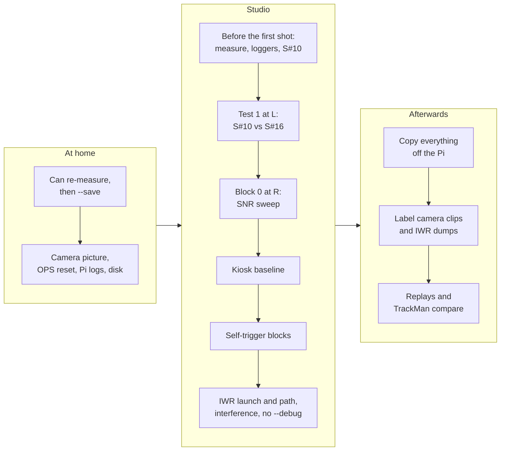
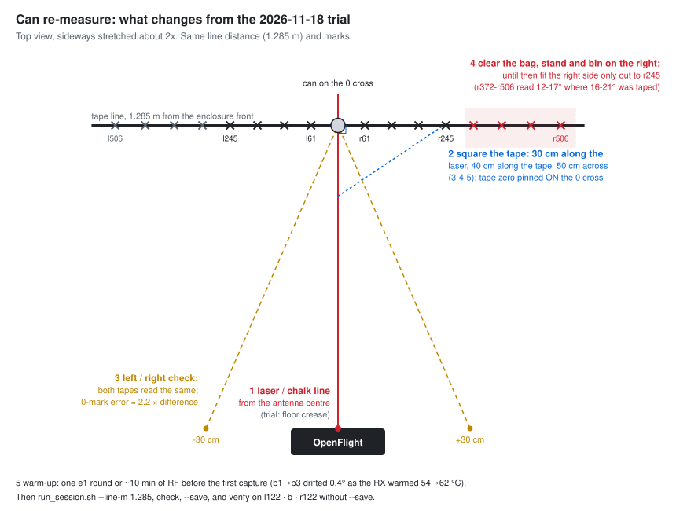
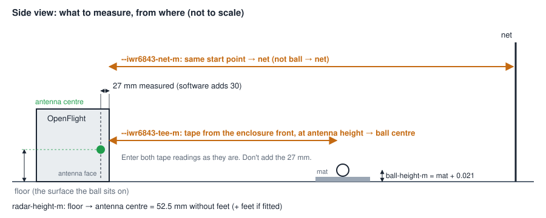
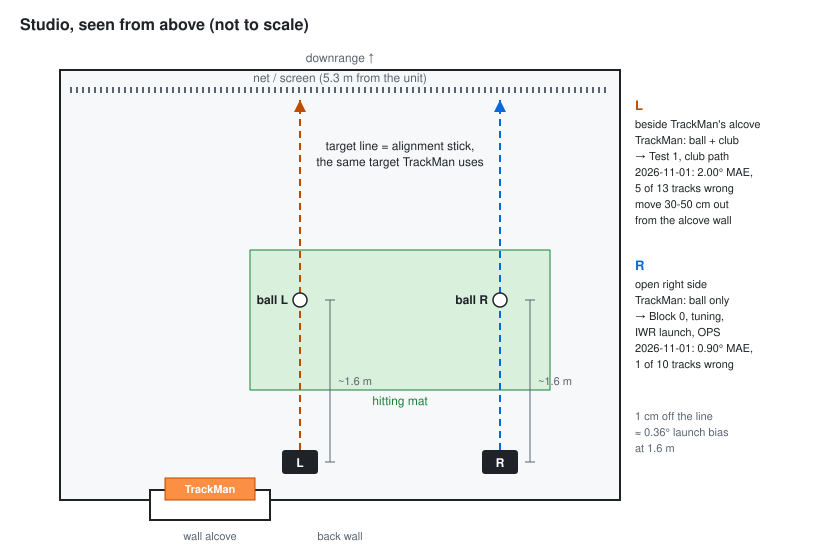
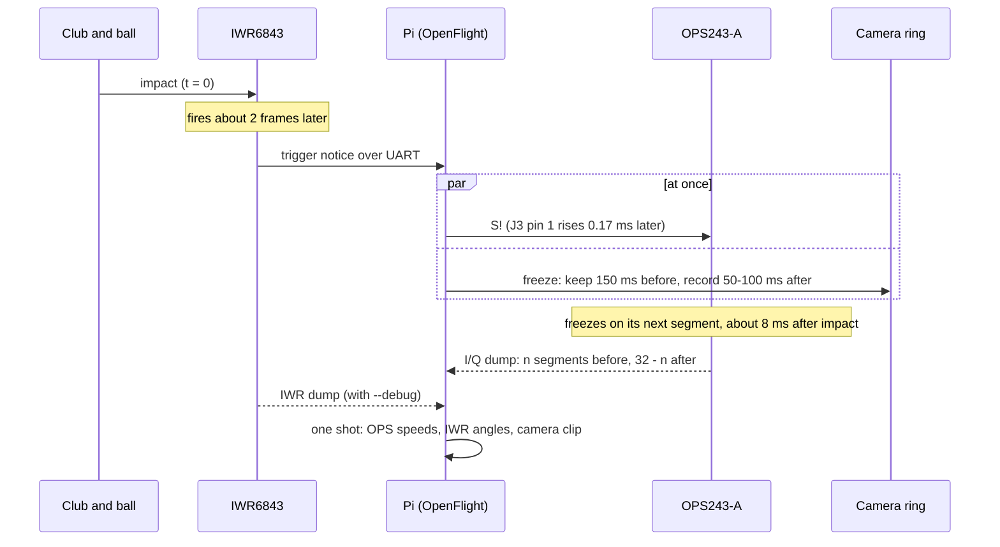
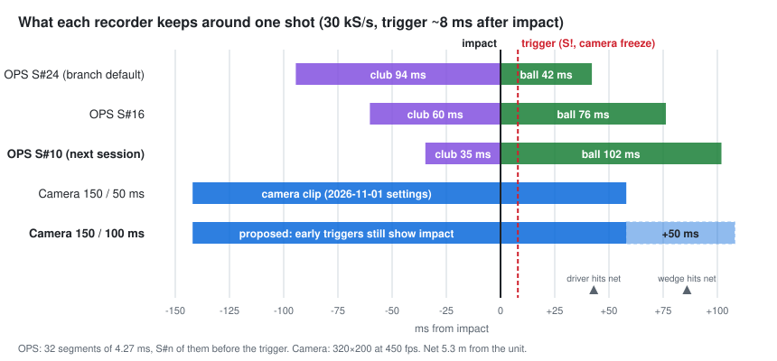
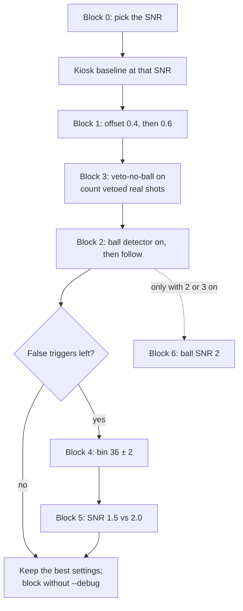
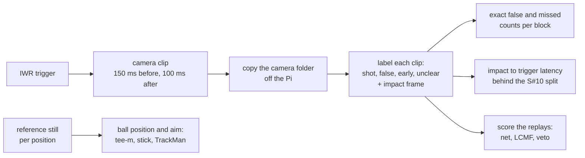

# Next studio tests

What to run on the next studio visit, from the
[2026-11-01 session](reports/studio-session-2026-11-01/README.md) and
[issue #2](https://github.com/HuggeK/OpenFlight-Radar-Workbench/issues/2)
(input parameters for the recessed IWR mount, the can azimuth calibration and
the combined plan). Change one thing per block, about 15 shots each, and note
every false shot and every real shot that did not register, with its time or
shot number.



## At home, before the session

### IWR azimuth: re-measure with the can, then save

The azimuth zero has never been saved. It is a constant bias on every
horizontal launch and club path, about **5 yd sideways per degree on a
driver** and 3 yd on a 7-iron, and it shifts the self-trigger's swing zone
sideways (1.2 cm at the tee per 0.44°). The 2026-11-18 hallway trial
([#2](https://github.com/HuggeK/OpenFlight-Radar-Workbench/issues/2), raw data
in [release `can-azimuth-2026-11-18-trial`](https://github.com/HuggeK/OpenFlight-Radar-Workbench/releases/tag/can-azimuth-2026-11-18-trial))
found a steady offset of about **−0.21 rad of phase (≈ 4°)**, very repeatable
(each mark's five freezes within 0.04°). It was a trial and was **not saved**.

Refitting the trial with the tape's zero as a free unknown (2026-11-22) gives
−0.212 rad again, so the value holds. What is left, 1-3° on single marks, comes
from the set-up: the can on the 0 cross sat 2-4 cm off the tape's zero, the
boresight was a floor crease, the cross tape was not squared, and the bag,
stand and bin on the right hid the can beyond r245. Re-measure once with those
fixed, then save:



- [ ] Kiosk stopped (it owns the UART); unit on the floor without feet, taped
      down, as in the trial.
- [ ] **1** Laser or chalk line from the antenna centre (the point halfway
      between the RX row and the TX group, see #2 §1), not a floor crease.
- [ ] **2** Cross tape squared with 3-4-5 (30 cm along the line, 40 cm along
      the tape, 50 cm across), its zero pinned **on** the 0 cross.
- [ ] **3** Left/right check before `e1`: tapes from two points on the front
      face, 30 cm either side of the antenna mark, to the 0 cross. Note the
      difference; the 0 cross is off by about 2.2 × that difference.
- [ ] **4** Clear the right side of the line (bag, metal stand, bin). If it
      cannot be cleared, use `--marks "61 122 183 245"`.
- [ ] **5** Warm up: one `e1` round or ~10 min of RF before the first capture
      (b1 → b3 drifted 0.4° as the RX warmed from 54 to 62 °C).
- [ ] Capture and analyse with the session script from #2:

      ```bash
      mkdir -p ~/bench/can_az_$(date +%Y%m%d) && cd ~/bench/can_az_$(date +%Y%m%d)
      curl -fsSLO https://raw.githubusercontent.com/HuggeK/OpenFlight-Radar-Workbench/assets/issue-2-diagrams/tools/can-azimuth/run_session.sh
      bash run_session.sh --line-m 1.285      # the line distance you actually tape
      ```

- [ ] Save only when the checks from #2 pass:

      | Check | Good |
      | --- | --- |
      | Fit slope | 0.9-1.1 (the script refuses outside 0.7-1.3) |
      | Median lateral error after the fit | ≤ 2 cm (about 0.8° at 1.3 m) |
      | Offset from e1 / e2 / e3 | the same, or one grid step (0.25° of phase) apart |
      | Boresight b1 → b2 → b3 | within 0.2° |
      | Offset against the trial (−0.21 rad) | within about 0.2°; if not, find out why before saving |

      ```bash
      ~/openflight/.venv/bin/python ~/openflight/scripts/iwr6843/azimuth_check.py manifest_e2.json --save
      ```

      `--save` writes `~/.config/openflight/iwr6843_calibration.json`, keeps
      the old file as `.prev` and keeps `radar_height_m: 0.0525`.
- [ ] Verify the saved value: capture `b`, `r122` and `l122` again in a new
      folder (`run_session.sh --line-m 1.285 --marks "122" --dir ...`) and run
      `azimuth_check.py` on it **without** `--save`. Its
      `applied_azimuth_offset_rad` must be the saved value, and the fitted
      offset must agree with it within one grid step.
- [ ] **Keep `--iwr6843-azimuth-offset-deg 0`** in the launcher. The can value
      is a phase the firmware gets from the calibration file; the flag is a
      separate mount-yaw correction in degrees, added to launch and path
      afterwards. Putting the can value there counts it twice, in the wrong
      unit.
- [ ] Publish the folder (captures, manifests, reports, `session.log`) as a
      release, like the trial.

### Camera: check the picture

On 2026-11-18 the OpenFlight camera gave a black frame, at auto exposure and at
a fixed 200 ms. The camera clips are the ground truth for the
[offline tests](#camera-record-every-trigger-for-offline-tests), so fix it at
home:

- [ ] Power off, then check for a lens cover and reseat the ribbon cable at both
      ends.
- [ ] `rpicam-hello --list-cameras` lists the OV9281 with the 320×200 mode (the
      high-speed driver must be rebuilt after a kernel upgrade).
- [ ] Start the kiosk with the session's camera flags and save a still:
      `curl -s http://localhost:8080/api/camera/preview.jpg -o still.jpg`.
      Focus on the ball at the tee distance and lock the focus.

### OPS: clean saved settings (keep rolling-buffer mode saved, for now)

The sound trigger is gone, so the HOST_INT reason for saving rolling-buffer
mode to the OPS's flash is gone too. **But do not remove it yet:** with
`--iwr6843-self-trigger` the OPS still starts the sound-trigger way
(`prepare_persisted_rolling_buffer()` in `feat/iwr-self-trigger`), which
never sends `GC` and expects the OPS to *boot* in rolling-buffer mode. Without
the saved mode the OPS boots in normal mode and the IWR's `S!` gives no dump.

What to do instead:

- [ ] Reset the OPS's saved settings to factory defaults (the reset command
      is in OmniPreSense's API document AN-010; check it there first), then
      re-run the one-time setup and power-cycle:

      ```bash
      uv run python scripts/hardware-test/test_rolling_buffer_persist.py --setup
      # unplug the OPS for 3 s, plug it back in
      uv run python scripts/hardware-test/test_rolling_buffer_persist.py --test
      ```

      The setup saves `GC` and `S#16` but never clears the speed trigger, so
      a speed trigger left over from an `--trigger hardware` run can be saved
      with it. That is the likely cause of Robinante's "OPS fires on its own
      before the IWR's S!" (2026-11-22).
- [ ] Self-fire check: OpenFlight running with `--iwr6843-self-trigger`,
      nobody moving, 10 minutes. Any OPS dump in the OPS tail without an
      `S!` just before it is the OPS firing on its own. On 1.3.3 its UART
      trigger message says it was the speed trigger; without that message,
      check that HOST_INT (J3 pin 3) is not floating now the mic is gone
      (10 kΩ pull-down to GND).
- [ ] OPS frequency commands for the
      [interference test](#ops-and-trackman-interference-robinantes-offset-theory):
      `?F`, `T=-2`, `?F`, then check that `T=0` undoes it and whether it
      survives a power cycle. Never send `A!` here.
- Follow-up for `feat/iwr-self-trigger`, not for this session: send `GC`,
  `S#` and "speed trigger off" at startup on the `S!` path, like
  `--trigger hardware` does. Then the saved rolling-buffer mode and its
  setup script can go.

### Pi: logs that survive a reboot

- [ ] Keep the system journal on disk permanently (not only for this
      session), with a size cap so it cannot fill the card:

      ```bash
      sudo mkdir -p /var/log/journal
      sudo sed -i 's/^#\?Storage=.*/Storage=persistent/; s/^#\?SystemMaxUse=.*/SystemMaxUse=500M/' /etc/systemd/journald.conf
      sudo systemctl restart systemd-journald
      journalctl --disk-usage            # check it took
      journalctl --list-boots | tail -3  # older boots should now be kept
      ```

### Pi: room for recordings

Each trigger saves a ~0.7 MB IWR dump (with `--debug`), the OPS capture and a
camera clip (5.8 MB at 150/50 ms, ~7.3 MB at the 150/100 ms planned below);
2026-11-01 used 0.83 GB for 127 triggers. A session can reach several GB.

- [ ] See what is free and what is using it:

      ```bash
      df -h /
      du -sh ~/openflight_sessions ~/openflight_sessions/* | sort -h | tail
      ```

- [ ] Copy older sessions to the PC or a USB stick, check the copy, then
      delete them on the Pi:

      ```bash
      rsync -a --info=progress2 ~/openflight_sessions/ <pc-or-usb>:/openflight_sessions/
      ```

- [ ] Free system space: `sudo apt clean`,
      `sudo journalctl --vacuum-size=200M` (before turning on the cap above),
      and old `~/.cache/uv` builds if space is still short.
- [ ] Aim for at least ~10 GB free before the session.

## Before the first shot

### Measure



| Flag | Measure | 2026-11-01 |
| --- | --- | --- |
| `--iwr6843-tee-m` | Tape from the **enclosure front** (radar front face, at antenna height, not the bottom lip) → ball centre, horizontal. Enter the reading as it is: the software adds 30 mm for the antenna depth. | 1.57 |
| `--iwr6843-net-m` | Same start point → net (not ball → net) | 5.30 |
| `--iwr6843-radar-height-m` | Floor → antenna centre. **0.0525 m without feet**, already saved in the board calibration on the Pi, so no flag. With feet or a raised mount (the validated height is ~0.15 m): pass the real height. | 0.04 (board centre) |
| `--iwr6843-ball-height-m` | Same floor → ball centre = mat + 0.021 (4 cm mat → 0.061) | 0.04 (should be 0.061) |
| `--iwr6843-tilt-deg` | Inclinometer on the IWR mount; note both readings | 10.1 (inclinometer ~9.9) |
| azimuth | Nothing to pass: the calibration file from [the can](#iwr-azimuth-re-measure-with-the-can-then-save). Keep `--iwr6843-azimuth-offset-deg 0`. | 0, never calibrated |

Measure both heights from the floor the unit stands on (lay a level across if
the mat is higher). **Write down every raw tape reading**, not only the flag
values.

### Start and check

- [ ] Start OpenFlight from the desktop icon, not over SSH (Ctrl+C must work).
- [ ] The saved calibration is loaded: the kiosk log shows
      `[IWR6843] Calibration: /home/openfl/.config/openflight/iwr6843_calibration.json`,
      and

      ```bash
      python3 -c "import json,os;d=json.load(open(os.path.expanduser('~/.config/openflight/iwr6843_calibration.json')));print(d.get('azimuth_offset_rad'), d.get('radar_height_m'))"
      ```

      prints the can's offset and 0.0525.
- [ ] Tee check with the radar: with `--iwr6843-ball-detector on`, place the
      ball. Once it is locked, the banner's range (from the antenna) should be
      the tee tape + 0.030 m within one bin (4.7 cm). If they disagree by more
      than a bin, trust the radar and re-measure.
- [ ] `session_tools/build_info.sh studio` and `session_tools/gpio_j3_logger.sh`.
- [ ] Clock synced (`timedatectl`), battery charged above 0 °C.
- [ ] Persistent OS logs are on (`journalctl --disk-usage`; see
      [At home](#pi-logs-that-survive-a-reboot)), so kernel UART errors, NTP
      and RTC events around a sample-rate change survive a reboot.
- [ ] At least ~10 GB free (`df -h /`).
- [ ] Log the IWR's GPIO17 trigger edge next to J3 (GPIO18):
      `session_tools/gpio_j3_logger.sh 17`
- [ ] Keep the unit in **one position per block** and note any move with the
      time; on 2026-11-01 the IWR was much better on the right side than beside
      the TrackMan. Which block goes where: [Placement](#placement).
- [ ] Use `--session-location studio`, not a name that reads like TrackMan data.
- [ ] **Set the OPS buffer split to S#10:** add `--sound-pre-trigger 10` to the
      start command. Without it, `feat/iwr-self-trigger` uses S#24 whenever
      `--iwr6843-self-trigger` is on, which kept only ~42 ms of ball on
      2026-11-01 (see [OPS buffer split](#test-1-ops-buffer-split-s10-instead-of-s24)).
      Check the first capture: `trigger_offset_ms` should read **42.67**.
- [ ] Camera flags for the [offline tests](#camera-record-every-trigger-for-offline-tests),
      including `--camera-capture-post-ms 100`.
- [ ] **Run Robinante's log tails** in two extra SSH terminals for the whole
      session (forgotten on 2026-11-01). They also give every fire its cause
      (the 11-01 logs have no `cause=` lines; `triggerLog track` per #2 is
      the other way):

      ```bash
      session_tools/log_tails.sh iwr | tee ~/openflight_sessions/studio-iwr-tail.log
      session_tools/log_tails.sh ops | tee ~/openflight_sessions/studio-ops-tail.log
      ```

      Timeouts are normal. Check that it captures on a valid swing, stays
      quiet when nothing moves, and rearms (also after a timeout).
- [ ] Reference video: a phone on a tripod for the whole session. Clap at the
      start of each block and note the Pi time (`date +%T`), so the video, the
      logs and TrackMan can be lined up.
- [ ] Shakedown, one shot: OPS I/Q, IWR dump and rearm, and the camera clip
      all present.

## Placement

Two positions, as on 2026-11-01. The distance between OpenFlight and the
TrackMan does not bias the numbers: both measure the same ball from where
they stand. What matters is that each knows its own geometry (distances,
heights, tilt) and that both aim at the **same target line**, or horizontal
launch and club path carry a constant offset.



| Position | Where | TrackMan gives | 2026-11-01 |
| --- | --- | --- | --- |
| **R** | right side of the hitting area, looking downrange, open floor | ball data only | IWR launch 0.90° MAE vs TrackMan, 1 of 10 tracks wrong |
| **L** | left side, ball in TrackMan's hitting area beside its wall alcove | ball **and club** data | 2.00° MAE, 5 of 13 tracks wrong (wall reflections and aim suspected) |

Set-up at each position, and again after every move:

- [ ] Lay an alignment stick on the target line through the ball, the same
      target TrackMan uses. Put the unit behind the ball, centred on the
      stick, pointing along it. Each 1 cm sideways off the line biases
      horizontal launch by ~0.36° at 1.6 m.
- [ ] Ball ~1.6 m from the unit (the branch's ideal band is 1.45-1.75 m;
      closer gives a stronger ball echo and a longer IWR track, below 1.45 m
      the club's approach starts to leave the IWR window). Measure tee, net and
      heights as in [Measure](#measure).
- [ ] Ball detector (block 2) first: the banner should read **ideal**, with a
      range of the tee tape + 0.030 m and a ball azimuth near 0° (with the can
      calibration saved, what is left is the unit's aim error).
- [ ] Camera reference still, with the stick and the ball in place and nobody in
      view (see [Camera](#camera-record-every-trigger-for-offline-tests)).
- [ ] At **L**: move the unit 30-50 cm out from the alcove wall if TrackMan
      still reports club data there, and confirm it does before the block.
- [ ] Note the position letter and time in the notes for every block. Never
      compare R and L shots in one table.

| Block | Position | Why |
| --- | --- | --- |
| **First:** S#10 block for club speed and smash | **L** | needs TrackMan club data |
| **First:** S#16 comparison block | **L**, same clubs | compared with the S#10 block at L |
| Block 0 (`swing_trigger.py` sweep) | R (or at home) | trigger only, no reference needed |
| Kiosk baseline and self-trigger tuning | R | IWR and trigger, ball data is enough |
| IWR launch vs TrackMan | R | best IWR results, no wall |
| OPS ball speed and spin | R | ball data |
| IWR club path vs TrackMan | **L** | needs TrackMan club data |
| OPS `T=-2` interference test | R and L | the test is the position difference |
| Block without `--debug` | R | trigger and rearm timing |

## Test 1: OPS buffer split (S#10 instead of S#24)

The OPS keeps 4096 samples (136.5 ms at 30 kS/s) in 32 segments of ~4.27 ms;
`S#n` is how many segments it keeps *before* the trigger. The IWR fires ~2
frames after launch and `S!` reaches the OPS in 0.17 ms, so the trigger lands
about 8 ms after impact (including the wait for the OPS's next segment). The
flag is still called `--sound-pre-trigger`, but it sets the OPS split for any
trigger that reaches the OPS as `S!`.





| S#n | Before trigger | Club before impact | Ball after impact | `trigger_offset_ms` | J3 window (post-trigger) |
| --- | --- | --- | --- | --- | --- |
| 24 (branch default, 2026-11-01) | 102.4 ms | ~94 ms | ~42 ms | 102.00 | ~34 ms |
| 16 | 68.3 ms | ~60 ms | ~76 ms | 68.27 | ~68 ms |
| **10 (next session)** | 42.7 ms | ~35 ms | ~102 ms | 42.67 | ~94 ms |

Why 10: ~35 ms of club (a driver head covers ~1.5 m in that time) is enough
for club speed and the club-to-ball impact estimate, while the ball window
grows from ~42 to ~102 ms for spin and speed-curve launch estimates
([issue #355](https://github.com/open-flight/openflight/issues/355)). It also
keeps shots whose trigger fires 60-70 ms *early* (3 on 2026-11-01): their
impact still lands inside the buffer, where S#24 lost them. Indoors the ball
hits the net after ~43 ms (driver) to ~86 ms (wedge), so the gain shows most
on wedges and chips, and outdoors. The camera clips measure the ~8 ms this
rests on, shot by shot (see [Camera](#camera-record-every-trigger-for-offline-tests)).

This is the first test of the session, before Block 0, at position **L**
(TrackMan club data, see [Placement](#placement)):

- [ ] Block A, `--sound-pre-trigger 10`: 15 shots, mixed clubs (driver,
      7-iron, wedge), noting each club.
- [ ] Block B, `--sound-pre-trigger 16`: the same 15 shots with the same clubs.
- [ ] Compare **club speed and smash** against TrackMan between A and B. If
      they hold at S#10, keep S#10 for every later block and propose it as
      the self-trigger default in `feat/iwr-self-trigger`; if not, run the
      rest at S#16 and note why.
- [ ] Note any shot where the OPS `impact_offset_from_trigger_ms` is missing
      or the club phase looks cut short.

## Block 0: sweep the self-trigger without the kiosk

[`scripts/iwr6843/swing_trigger.py`](https://github.com/open-flight/openflight/blob/feat/iwr-self-trigger/scripts/iwr6843/swing_trigger.py)
in the OpenFlight checkout arms the IWR self-trigger on its own: it samples
the empty lane for 2 s (prints the floor p95 and the threshold), arms
`triggerCfg` at `--snr`, and for every fire prints the club track and
**PASS** when the club track's range impact fired. No OPS, no readback, so no
7.7 s blind window: a fast way to count what fires the trigger.

Stop the kiosk first (it owns the UART). Then, per SNR:

```bash
cd ~/openflight
uv run --no-sync python scripts/iwr6843/swing_trigger.py \
  --port /dev/serial/by-id/usb-Silicon_Labs_CP2105_Dual_USB_to_UART_Bridge_Controller_01310F8D-if00-port0 \
  --tee-m 1.57 --snr 1.5
```

| SNR | Real swings (10) | Addresses (5) | Waggles (5) | Takeaways stopped at hip (5) | Downswings stopped short of the ball (5) | Whiffs (3) | Practice swings beside the ball (5) | Walking past (1 min) |
| --- | --- | --- | --- | --- | --- | --- | --- | --- |
| 1.5 | | | | | | | | |
| 2.0 | | | | | | | | |
| 3.0 | | | | | | | | |

Note the floor p95 for each run (it says how noisy the bay is), and for every
fire its cause and whether it is PASS (club track) or FAIL (something else).
Ctrl+C prints `passed/swings`. Pick the SNR for the kiosk blocks from this
table. No camera clips here: the kiosk is stopped.

## Kiosk baseline

The kiosk with the SNR picked in Block 0 and no tuning flag, 15 shots at R. Every
self-trigger block below is compared with this one (2026-11-01: 57 of 76 real
shots on time).

## Self-trigger tuning

All need `--iwr6843-self-trigger`. One flag per block on top of the
baseline. Run them in this order; short on time, stop after block 3:



| Block | Flag | Default | Try | What to look for |
| --- | --- | --- | --- | --- |
| 1 | `--iwr6843-self-trigger-offset-m` | 0.2 (whole bins) | 0.4, then 0.6 | Moves the watched bin past the ball so a swing's line must carry beyond it. 0.2 (bin 36) did not stop backswings and waggles on 2026-11-01. Does a larger offset stop address/backswing triggers without missing shots? |
| 2 | `--iwr6843-ball-detector` | off | on, then follow | `on` locks the placed ball for the onboard shot machine and drives the kiosk's "ball placed" banner; `follow` also aims the self-trigger at the locked ball. Does the banner track ball placement, and does `follow` reduce false triggers? The banner's poll holds the IWR serial port about once a second. |
| 3 | `--iwr6843-veto-no-ball` | off | on | Skips the readback and rearms at once when the firmware sees no ball flight (waggle, raking a ball over). Shortens the 7.7 s blind window after a false trigger; off by default because the firmware's ball tracker still misses real balls. Count real shots it vetoes: the camera clip of each vetoed trigger shows whether a ball left. |
| 4 | `--iwr6843-self-trigger-bin` | from `--iwr6843-tee-m` | 36 ± 2 | Sets the watched range bin directly (not with `offset-m`). Only if blocks 1-3 leave false triggers. |
| 5 | `--iwr6843-self-trigger-snr` | 1 | 1.5 vs 2.0, same block length | 2.0 caught real shots and 3.0 missed them on 2026-11-01, but neither stopped false triggers. Confirm with the tails running. |
| 6 | `--iwr6843-ball-snr` | firmware's, 1 | 2 | Ball tracker threshold, separate from the trigger SNR. Only with block 2 or 3. |

For each block, at the end:

```bash
python -m openflight_bench.session triage --triggers terminal_logs/kiosk_*.log
```

and walk a few minutes around the unit without swinging, then address and
waggle without hitting, to count movement triggers.

## Camera: record every trigger for offline tests

With `--iwr6843` the camera freezes on the IWR's trigger (not on GPIO17), and
it saves a clip for **every** trigger the IWR accepts, real or not. A clip that
matches no shot is logged as unmatched but stays on disk. Those clips are the
only record of what really happened at each trigger, so they can serve as
ground truth for checking and tuning the parameters afterwards.



| Question | What to read in the clip | What it checks or tunes | Tool |
| --- | --- | --- | --- |
| Real shot, false trigger or early trigger? | Ball gone after the trigger frame, or still on the mat; club through the ball or not | Block 0 and blocks 1-6 counts; real shots that `--iwr6843-veto-no-ball` vetoed | [`camera_strip.py`](../session_tools/camera_strip.py) |
| When was impact? | First frame where the ball has moved; 450 fps is 2.2 ms per frame | The ~8 ms impact → trigger the S#10 split rests on, and its spread; early triggers | Per-frame `host_timestamp_ns` against `trigger_host_timestamp_ns` in `frames.npz`; by eye in the strip for now |
| Did the ball sit where the flags say? | Ball position in the frame at address, shot to shot | `--iwr6843-tee-m`, the ball detector's `range_m` and `move_cm` | Reference stills (below) |
| Which way did it start? | Ball direction in the first frames after impact, against the stick in the reference still | Aim error (camera, IWR and TrackMan all shifted) vs IWR reflections at L (only the IWR off) | `--camera-shot-analysis` (experimental) |

What the clips cannot do: a missed trigger leaves no clip (count those in the
notes), and the firmware's trigger settings (SNR, offset, bin, ball SNR)
cannot be re-run offline, because the IWR only dumps when it fires. The clips
make the counts exact and score the host-side replays (`iwr_net_replay.py`,
`lcmf_height_replay.py`); each firmware setting still needs its own block.
Do not calibrate the radar's azimuth against the camera (#2): that only lines
the radar up with the camera, and misses an error both share against the
target line. The camera can show when the two disagree.

- [ ] Picture checked at home ([Camera: check the picture](#camera-check-the-picture)).
- [ ] Camera flags in the launcher: `--camera-capture`, 320×200 at 450 fps,
      `--camera-capture-pre-ms 150` and **`--camera-capture-post-ms 100`**
      (was 50). On 2026-11-01 a real 122 mph shot looked like a false trigger
      because the trigger came 60-70 ms early and the 50 ms ended before the
      club arrived. ~7.3 MB per clip instead of 5.8 MB; 150 triggers ≈ 1.1 GB.
- [ ] Camera inputs measured:

      | Flag | Measure |
      | --- | --- |
      | `--camera-capture-mount-height-m` | Floor → lens centre (default 0.20955) |
      | `--camera-capture-lateral-offset-m` | Lens centre sideways from the IWR antenna centre, + = target-right |
      | *(no flag)* | Lens in front of the IWR antenna face (the model assumes the same plane) |
      | `--camera-capture-roll-deg` | Only if the strip is visibly tilted |
      | *(UI)* | Sensor strip `vertical_offset_px` after putting the ball on the + |
      | *(lens)* | Focus locked; a camera calibration is valid for one focus only |

- [ ] Reference still at each position, after the set-up checklist, with the
      alignment stick on the target line, the ball on the tee and nobody in
      view:

      ```bash
      curl -s http://localhost:8080/api/camera/preview.jpg \
        -o ~/openflight_sessions/studio/ref_R_$(date +%H%M%S).jpg   # ref_L_ at L
      ```

      The still comes from the preview stream. Check once that it shows the
      same view as a clip's `trigger.pgm`.
- [ ] Note the club for every block (the clip shows the strike, not the club).

## OPS and TrackMan interference (Robinante's offset theory)

The OPS243 and TrackMan both radiate in the same room; shifting the OPS
carrier away from TrackMan's might remove interference. With OpenFlight
**stopped** (the OPS port free), on `/dev/ttyAMA0` at 230400 baud:

1. `?F` and note the frequency.
2. `T=-2` (frequency offset), wait 15 s, `?F` again.
3. Start OpenFlight, hit 10 shots at both positions (beside TrackMan and
   away from it) and compare ball and club speed with TrackMan's numbers.

Try it at home first (see [At home](#ops-clean-saved-settings-keep-rolling-buffer-mode-saved-for-now)),
and run it only after the ×1.49 sample-rate problem below is ruled out.

On 2026-11-01 the large speed errors were not interference: the OPS read
1.49 × TrackMan from 11:37:53 until a restart, in both positions (see below).
Export TrackMan through SwingSync again and run
`python -m openflight_bench.session compare` to size what is left.

## OPS sampling change (×1.49 speeds)

- [ ] Keep `gpio_j3_logger.sh` running and watch the J3 window: at S#10 and
      30 kS/s it should be ~94 ms; ~140 ms means the OPS slowed to 20 kS/s
      (×1.5, as on 2026-11-01, when S#24 went from ~34 to ~48-51 ms). The
      `S#24` → `S2` theory below means any `S#` re-arm can do this, so keep
      the check whatever the split.
- [ ] When it happens, stop OpenFlight and query the OPS before any restart:
      sample rate and module settings (`S?`, `??`; confirm the query commands
      in OmniPreSense's API document AN-010 first), and save the replies.
- [ ] Note what happened just before (here: a normal rearm at 11:37:26, the
      shot before had 83.5 mph and 1.34 % clipped samples).
- [ ] Check whether a restart alone fixes it (it did on 2026-11-01).
- [ ] Check without J3 too: every `rolling_buffer_capture` in the session
      JSONL carries the OPS's `trigger_offset_ms`. At S#10 that is 42.67 at
      30 kS/s and 64.0 at 20 kS/s (S#24 on 2026-11-01: 102.0 and 154.0).
- [ ] Read the OPS's UART error counters (`query_uart_baud()` in
      `openflight.ops243`) before and after the session.
- [ ] Note the time of the "cue" games (poking the ball to set off the
      trigger): the camera only records around a trigger, so only the log
      shows what happened between triggers.

## Other checks

- A block **without `--debug`**: the blind window should drop from 7.7 s to
  about 1 s, and `l3release refused` should disappear. No LCMF launch then.
- Quick double shots: is the IWR ready again within 2 s of the previous one?
- Practice swings away from the radar's beam, to confirm they are the cause.
- `--debug` UI request: show shot times (HH:MM:SS) in the history tab.

## After the session

- [ ] Copy everything off the Pi before deleting anything: the whole
      `~/openflight_sessions/studio` folder (camera clips, IWR dumps, JSONL),
      `terminal_logs/`, both tails, the J3 and GPIO17 logs and the reference
      stills, plus the phone video. On 2026-11-01 the clips stayed on the Pi.
- [ ] Trigger timing: `session_tools/export_camera_triggers.py` →
      `python -m openflight_bench.session latency --camera ... --gpio ...`.
- [ ] Label every camera clip in `camera_labels.csv`
      (`capture,label,impact_frame,club,note`; label is `shot`, `false`,
      `early` or `unclear`), and the on-time IWR dumps in the dump viewer's
      annotate mode, with TrackMan as the reference.
- [ ] `triage` and, with the SwingSync export, `compare`. Give every count with
      its denominator, per block and position.
- [ ] Publish the session as a release, with the `.l3dump` files.
