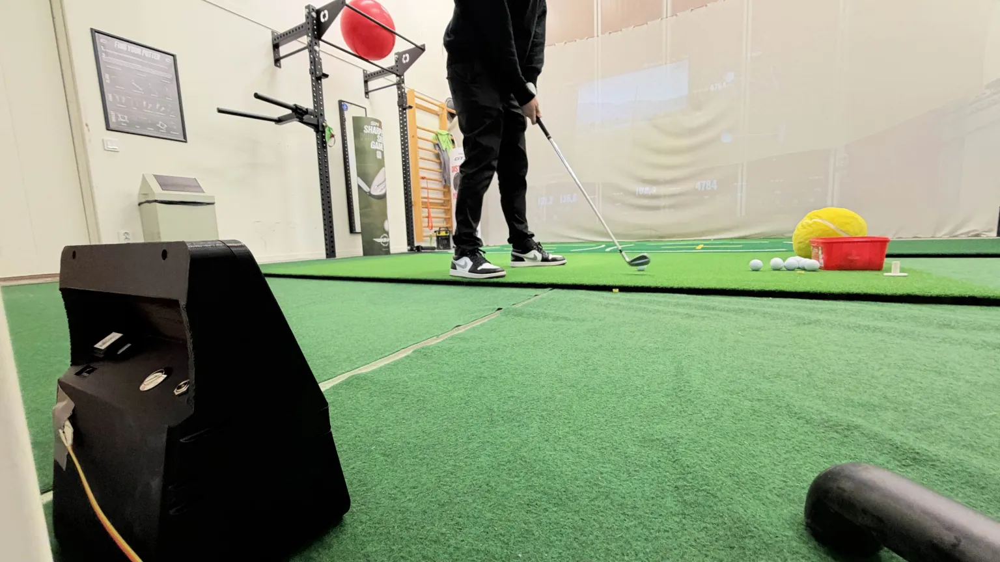
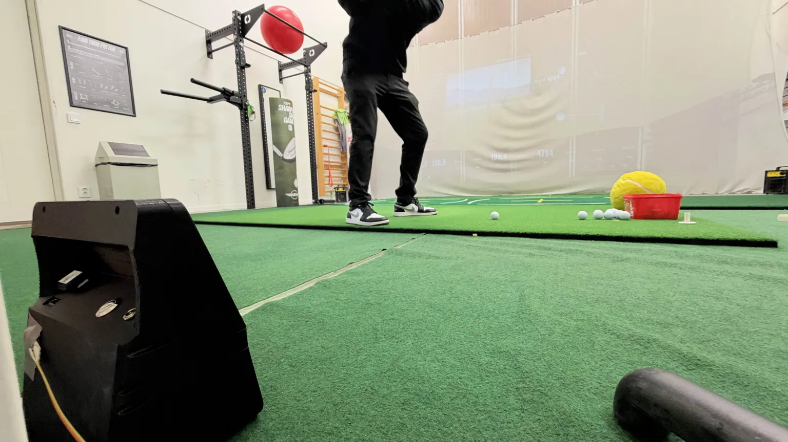
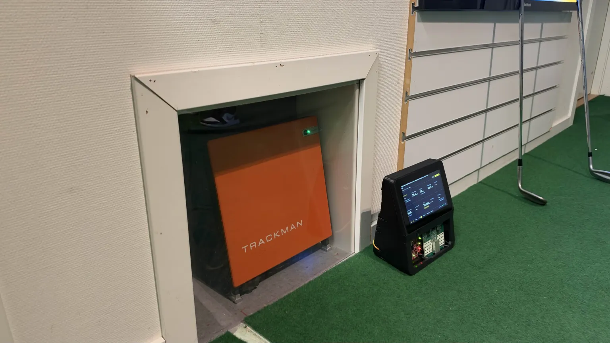
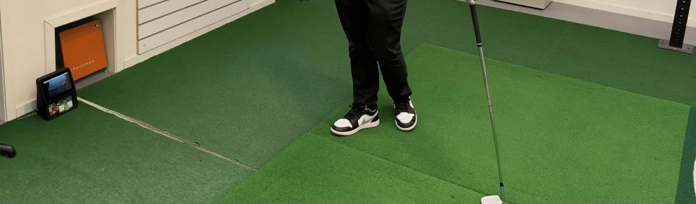
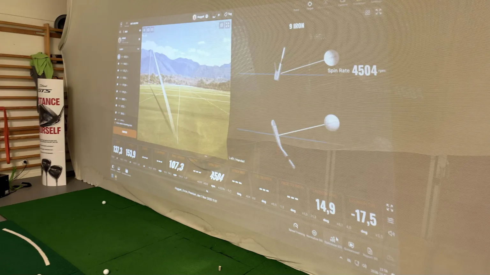

# Studio session, 2026-11-01: IWR self-trigger beside a TrackMan 4

An indoor studio session with OpenFlight on the IWR6843 self-trigger (no sound
sensor), hitting into a net beside a TrackMan 4. Goals: focus the camera, tune
the self-trigger, and benchmark trigger latency with and without real-time
scheduling. TrackMan's shots were exported afterwards through SwingSync and
matched shot by shot. All numbers come from the files in [`data/`](data/),
through `python -m openflight_bench.session` (see
[session tools](../../../session_tools/README.md)).

**Interactive report:** [claude.ai artifact](https://claude.ai/artifact/1Han6jXZFAemhFNtt7A4fu) with every camera clip (annotated), an IWR range-time map per capture, the J3 chart and a log viewer.

**PDF:** [OpenFlight-studio-session-2026-11-01.pdf](OpenFlight-studio-session-2026-11-01.pdf)
(TL;DR, all tables, camera strips).

## TL;DR

- **The OPS243 read 1.49 × TrackMan's ball speed from 11:37:53 until a
  restart at 12:35.** Its capture window grew from 34 to 48 ms at the same
  moment; it looks like the radar dropped from 30 to ~20 kS/s mid-run.
  Outside that period ball speed matched TrackMan to 0.995 ± 0.028.
- **The self-trigger caught 57 of 76 real shots on time (75 %).** Six fired
  on the takeaway or backswing, ten never fired, three fired 60-70 ms early.
- **False triggers are frequent and SNR does not fix them.** Addresses,
  waggles, practice swings, placing a ball and walking up fired it at SNR 1.5,
  2.0 and 3.0; each one blinds the IWR for 7.7 s.
- **IWR launch was 2.4° MAE (n=8)**, three times the project's 0.83°
  baseline. `--iwr6843-net-m` is unit → net; ball → net clipped every track.
- **Real-time scheduling buys nothing:** S! reaches the OPS in 0.17 ± 0.01 ms
  either way.

## Lessons learned

1. **The OPS243 changed its sampling in the middle of a run.** From
   11:37:53 until OpenFlight was restarted at 12:35, every ball speed read
   1.49 ± 0.04 × TrackMan (27 shots) and club speed 1.37 ×. Before and after,
   ball speed matched TrackMan to 0.995 ± 0.028. The OPS post-trigger window
   on J3 pin 1 grew from ~32 ms to ~48 ms (×1.5) at the same moment, the log's
   `post-trigger` went from 34.5 ms to 0.0 ms, and the clock sync went from 36
   to 59 valid readings; no host command was sent in between. The OPS's own
   trigger offset in every `rolling_buffer_capture` record went from exactly
   102.00 ms to exactly 154.00 ms: S#24's 3072 pre-trigger samples at
   30 kS/s, then at 20 kS/s. It was not an OPS reboot (it powers up at
   30 kS/s in continuous mode, checked 2026-11-01 evening) and not the move
   (~11:52). The OPS reports UART receive errors (4 noise, 4 framing, 1 break
   since boot); one candidate is a re-arm `S#24` that lost its `#` and read
   as `S2` (20 kS/s) — to be confirmed against OmniPreSense's API. A restart
   fixed it.
2. **`--iwr6843-net-m` is unit → net, not ball → net.** 3.0 m (meant as ball
   → net) left the tracker 0.5 m (~10 ms) of flight. Replay with 4.6 m tracked
   24-41 ms on every real shot. Measured unit → net was 5.30 m.
3. **The self-trigger caught 75 % of real shots on time.** Of TrackMan's 76
   shots: 57 captured on time, 6 triggered ~0.7 s early on the backswing (the
   OPS then read the slow backswing, 20-50 mph), 10 had no trigger at all, 3
   triggered 60-70 ms early so the OPS window closed before impact.
4. **False triggers are frequent and SNR does not fix them.** OpenFlight saved
   20 shots and logged 41 no-ball triggers with no TrackMan shot behind them:
   addresses, waggles, practice swings (27-29 readings, up to 74 mph "ball"),
   placing a ball, walking up to the screen. At SNR 2.0 and 3.0 a practice
   swing still triggered; at 3.0 real shots went missing.
5. **Every trigger blinds the IWR for ~7.7 s** with `--debug` (7.1 s readback
   plus a radar restart), so a false or early trigger costs the next real shot.
6. **IWR launch angles were 3× worse than the project's baseline.** LCMF on
   shots with correct OPS speed: 2.4° MAE, 1.4° median, +1.5° bias (n=8),
   against 0.83° / 0.67° / −0.04° in the
   [project's TrackMan validation](https://github.com/open-flight/openflight/blob/feat/iwr-self-trigger/docs/how-it-works/launch-angle.md).
   Few shots, and the radar sat lower (0.04 m) than any validated mount
   (0.1524 m). Replaying 31 shots with the real ball-centre height (0.061 m:
   4 cm mat + 2.1 cm radius, not 0.04 m) cut the bias on the 23 good tracks
   from +0.87° to +0.39°; 8 shots stayed 5-11° off, so wrong tracks, not
   geometry, dominate ([`lcmf_height_replay.txt`](data/lcmf_height_replay.txt)).
   Measure radar height to the centre of the IWR antenna group and ball height
   to the ball centre, both from the floor the unit stands on.
10. **The clocks were fine.** NTP (systemd-timesyncd) syncs whenever there is
    a connection; the RTC battery charges (`rtc_bbat_vchg=3000000`) and kept
    the time across power-off. TrackMan's clock, not the Pi's, was 425.5 s off.
11. **Do not mix unit positions when comparing the IWR.** On the right side
    of the hitting area (11:32-11:52) IWR launch matched the 0.83° baseline
    (0.90° MAE, 1 of 10 tracks wrong); after moving to the left side beside
    the TrackMan it was 2.00° MAE with 5 of 13 tracks wrong. Trigger and OPS
    behaved the same in both places. See [Moving the unit](#moving-the-unit-right-side-to-left-side).
7. **Real-time scheduling buys nothing.** S! reached the OPS 0.17 ± 0.01 ms
   after the host acted, with or without `chrt -f 50`.
8. **The UI banner "TI radar capture failed" is misleading.** It appears on
   every shot because the firmware never has an onboard result ready
   (`triggerLog result` → `ready=0`). Data is still saved.
9. **Launch OpenFlight from the desktop icon.** Started over SSH with
   `nohup … &`, the server ignored SIGINT and had to be stopped with SIGTERM,
   which skips the OPS idle step.

## Setup

| Item | Value |
| --- | --- |
| OpenFlight | `feat/iwr-self-trigger` + 2 local commits (OPS idle, backlight), see [`trackman-build-info.txt`](data/trackman-build-info.txt) |
| IWR6843 firmware | 1.0.3 (git 4e4e9c5d94b7, hybrid-cadence, built 2026-10-09) |
| OPS243-A | firmware 1.3.3, GPIO UART `/dev/ttyAMA0` at 230400 baud, rolling buffer S#24, 30 kS/s |
| Trigger | IWR self-trigger (`triggerCfg 36 <snr> 1`, default offset 0.2 m), no SEN-14262 |
| Geometry | ball 1.57 m, net 5.30 m (from 11:32), IWR board centre 0.04 m above the floor, tilt 10.1° (inclinometer ~9.9°) |
| Camera | OV9281, 320×200 at 450 fps (430.9 delivered, 0 gaps on 127 captures), 150 ms pre / 50 ms post |
| Extra wiring | OPS J3 pin 1 → Pi pin 12 (GPIO18), logged with `gpiomon` |
| Flags | `--debug` (full IWR readback), `--session-location trackman` |
| Reference | TrackMan 4, exported with SwingSync ([`swingsync-2026-11-01.csv`](data/swingsync-2026-11-01.csv)); its clock ran 425.5 s ahead of the Pi's NTP time |











## Runs

| Log | Time | SNR | Net | Triggers | Shots | No-ball triggers |
| --- | --- | --- | --- | --- | --- | --- |
| [`kiosk_20261101_111546`](data/kiosk_20261101_111546.log) | 11:15-11:31 | 1.5 | 3.0 m ✗ | 20 | 10 | 10 |
| [`kiosk_20261101_113221`](data/kiosk_20261101_113221.log) | 11:32-12:34 | 1.5 | 5.30 m | 76 | 49 | 27 |
| [`kiosk_20261101_123514`](data/kiosk_20261101_123514.log) | 12:35-12:45 | 2.0 | 5.30 m | 17 | 11 | 6 |
| [`kiosk_20261101_124549`](data/kiosk_20261101_124549.log) | 12:45-12:55 | 3.0 | 5.30 m | 14 | 12 | 2 |

"No-ball triggers" are the UI's "impact detected" without metrics. Real-time
scheduling was on from 12:13:44 to 12:34 inside the second run.

## Against TrackMan

```
python -m openflight_bench.session compare --shots data/swingsync-2026-11-01.csv data/kiosk_20261101_*.log
```

The full per-shot table is in [`trackman_compare.txt`](data/trackman_compare.txt).
TrackMan stamps each shot 70 ± 29 ms after OpenFlight's IWR trigger, so a
trigger more than 0.3 s before TrackMan's stamp is an early one.

### Did each real shot get captured?

| Period | TrackMan shots | On time | Early (backswing) | No trigger | On time, OPS saw no ball |
| --- | --- | --- | --- | --- | --- |
| SNR 1.5, net 3.0 (11:15-11:31) | 8 | 7 | 0 | 0 | 1 |
| SNR 1.5 (11:32-11:37) | 6 | 5 | 0 | 1 | 0 |
| SNR 1.5, OPS ×1.49 (11:37-12:34) | 44 | 31 | 6 | 6 | 1 |
| SNR 2.0 (12:35-12:45) | 5 | 4 | 0 | 1 | 0 |
| SNR 3.0 (12:45-12:55) | 13 | 10 | 0 | 2 | 1 |
| **Total** | **76** | **57** | **6** | **10** | **3** |

Six of the "on time" captures still got a wrong OPS speed (0.14-0.71 ×
TrackMan): the OPS mode picked a slow component instead of the ball.

OpenFlight shots with no TrackMan shot behind them, i.e. false shots (or
balls outside TrackMan's zone): 11 at SNR 1.5, 7 at SNR 2.0, 2 at SNR 3.0.
Eleven are 16-31 mph from 1-11 readings; practice swings and a backswing gave
44-74 mph from 5-29 readings; one 187 mph shot (#18, 11:57) has no TrackMan
record.

### Accuracy, compared with the project's validation

| Measure | This session | Project baseline |
| --- | --- | --- |
| OPS ball speed − TrackMan, before cosine correction | −0.5 mph bias, 2.6 mph MAE (n=24) | −2.15 mph bias, 2.83 mph MAE (2026-06-08, 128 shots) |
| OPS club speed − TrackMan | −0.4 mph bias, 4.9 mph MAE, p50 2.7 (n=24) | — |
| IWR LCMF launch − TrackMan, irons | +1.5° bias, 2.4° MAE, p50 1.4° (n=8) | −0.04° bias, 0.83° MAE, p50 0.67° (87 shots) |
| LCMF coverage on captured shots | 24 of 57 (42 %) | 87 % strict, irons/wedges |

The baseline figures are from OpenFlight's
[launch-angle report](https://github.com/open-flight/openflight/blob/feat/iwr-self-trigger/docs/how-it-works/launch-angle.md)
and `src/openflight/speed_correction.py`. Only 24 shots here had a correct OPS
speed (outside the ×1.49 period), and LCMF uses OPS speed as an input, so the
16 LCMF results inside that period or the net-3.0 run (2.6° MAE) are not a
fair test.

### The ×1.49 period

| | Before 11:37:53 and after 12:35 | 11:37:53-12:34 |
| --- | --- | --- |
| OPS / TrackMan ball speed | 0.995 ± 0.028 (n=24) | 1.486 ± 0.035 (n=27) |
| OPS / TrackMan club speed | 1.00 ± 0.11 | 1.37 ± 0.13 |
| J3 window (S#24 post-trigger) | 30-34 ms | 46-51 ms |
| Log `post-trigger` | 34.5 ms | 0.0 ms |

It started between two shots with nothing logged in between but a normal
rearm, and survived the move next to the TrackMan at ~11:52, so it is not
TrackMan proximity. Not reproduced yet; see
[next tests](../../NEXT_STUDIO_TESTS.md).

## Moving the unit: right side to left side

At about 11:52 OpenFlight was moved from the right side of the hitting area to
the left side (looking downrange), next to the TrackMan 4 in its wall alcove,
so TrackMan could also give club data. Ball and net distances stayed the same.
Same run, SNR 1.5, TrackMan ball speed as the LCMF input
([`lcmf_height_replay.txt`](data/lcmf_height_replay.txt), ball 0.061 m):

| | Right side, 11:32-11:52 | Left side, 11:52-12:35 |
| --- | --- | --- |
| IWR launch − TrackMan, tracks within 4° | **0.90° MAE**, −0.34° bias (n=9) | 2.00° MAE, +1.85° bias (n=8) |
| IWR tracks off by more than 4° | 1 of 10 | **5 of 13** |
| Launch measured live, on-time real shots | 10 of 13 | 10 of 23 |
| False shots and no-ball triggers per minute | 0.50 | 0.53 |
| OPS ball / TrackMan, ÷ 1.5 (20 kS/s) | 1.002 (n=8) | 0.985 (n=19) |

On the right side the IWR matched the project's baseline; beside the TrackMan
it picked more wrong tracks. The alcove wall (extra reflections) and the aim
are the first suspects. Small samples: a lead, not a conclusion. Photos
IMG_2823 and IMG_2819 show the left-side position.

## IWR range-time maps

[`session_tools/iwr_maps.py`](../../../session_tools/iwr_maps.py) draws each
IWR capture's moving-target power by range and time (24 frames, 48 ms). A real
shot draws a streak climbing away from the ball line; an address, waggle or
practice swing stays near it. All 124 maps are in the interactive report,
next to each camera clip.

## Net distance

Shots from 11:18 to 11:27 ran with `--iwr6843-net-m 3.0`. Offline replay
([`iwr_net_replay.py`](../../../session_tools/iwr_net_replay.py)) on the same
dumps:

| Dump | net 3.0 | net 4.6 | no net |
| --- | --- | --- | --- |
| 111824_001 | reject, 9 ms | ok, 27 ms | ok, 27 ms |
| 111911_003 | reject, 9 ms | ok, 41 ms | ok, 43 ms |
| 112540_015 | reject, 13 ms | ok, 41 ms | ok, 41 ms |
| 112630_017 | ok, 16 ms | ok, 27 ms | ok, 27 ms |

## Trigger latency and the real-time A/B

`gpiomon` logged J3 pin 1 on GPIO18; each camera capture records the host's
trigger time on the same monotonic clock
([`camera_triggers_20261101.csv`](data/camera_triggers_20261101.csv),
[`ops_j3_20261101_111438.log`](data/ops_j3_20261101_111438.log)).

| Window | Scheduling | Triggers | S! → OPS (J3 rise) | OPS window (J3 rise → fall) |
| --- | --- | --- | --- | --- |
| 11:32-12:13 | normal | 54 | 0.17 ± 0.01 ms | 44.8 ± 6.1 ms (30-51) |
| 12:13-12:35 | `chrt -a -f 50` | 22 | 0.17 ± 0.01 ms | 47.5 ± 2.5 ms (41-51) |
| 12:35-12:45 | normal, new process | 17 | 0.16 ± 0.01 ms | 31.7 ± 1.8 ms (27-34) |
| 12:45-12:55 | normal, new process | 14 | 0.17 ± 0.01 ms | 32.1 ± 1.1 ms (31-34) |

The window "jitter" in the first row is the ×1.49 switch at 11:37:53 (34 →
48 ms), not scheduling. Impact → S! from the server log was 0.3 ± 3.6 ms
(n=44) normal and −0.4 ± 2.9 ms (n=12) real-time. **Verdict: do not make
real-time priority a default.**

## Other observations

- Camera: the alignment preview script always flips 180°; this unit's camera
  sits upright, so `--camera-capture-rotate-180` was removed and the lens
  refocused at 1280×800. A camera clip can look like a false trigger when the
  trigger came 60-70 ms early: the 50 ms post window ends before the club
  arrives (12:48:19, a real 122 mph shot).
- `l3release refused … self-trigger freeze timed out` after every `--debug`
  capture, then a radar restart. Fixed in firmware source by
  open-flight/openflight `cb8fbffb`; no binary yet.
- Only 3 captures failed (18-byte dumps), all on triggers where the OPS saw
  no ball.
- Storage: this session's recordings take ~0.83 GB on the Pi (127 camera
  clips at 5.83 MB, 124 IWR dumps at 0.73 MB, ~6.6 MB per trigger); the whole
  `~/openflight_sessions` folder was 1.4 GB with 16 GB free on a 32 GB card.
- Request: in `--debug`, show each shot's time (HH:MM:SS) in the history tab.

## Files

| File | Content |
| --- | --- |
| `data/kiosk_*.log` | Kiosk terminal logs, one per OpenFlight start |
| `data/session_*_trackman.jsonl` | OpenFlight session logs (shots, IWR results) |
| `data/swingsync-2026-11-01.csv` | TrackMan 4 shots, exported with SwingSync (UTC, km/h) |
| `data/trackman_compare.txt` | Shot-by-shot TrackMan ↔ OpenFlight table |
| `data/trackman-notes.txt` | Notes taken during the session, with the player's observations |
| `data/ops_j3_20261101_111438.log` | GPIO18 edges (monotonic seconds) |
| `data/radar_raw_20261101_*.log` | OPS243 event logs per run (trigger, dump, clock sync, rearm) |
| `data/launcher/` | `run-openflight.sh` as it stood for each run (flags, SNR, net) |
| `data/captures_20261101.json` | Every camera capture matched to its trigger, OPS verdict and TrackMan |
| `data/camera_triggers_20261101.csv` | Camera trigger timestamps, 127 captures |
| `data/trackman-build-info.txt`, `data/trackman-local-changes.patch` | Build stamp |
| `OpenFlight-studio-session-2026-11-01.pdf` | This report as a PDF, with camera strips |

The IWR dumps and camera clips stay on the Pi. The notes were written live;
where they call a ~20 mph shot "false", TrackMan shows that #22 and #23 (run
2) were real shots read wrong, and that the 12:48:19 trigger was a real shot.
